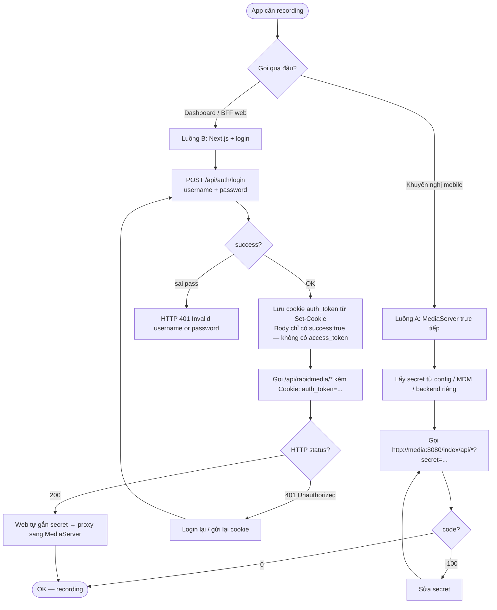
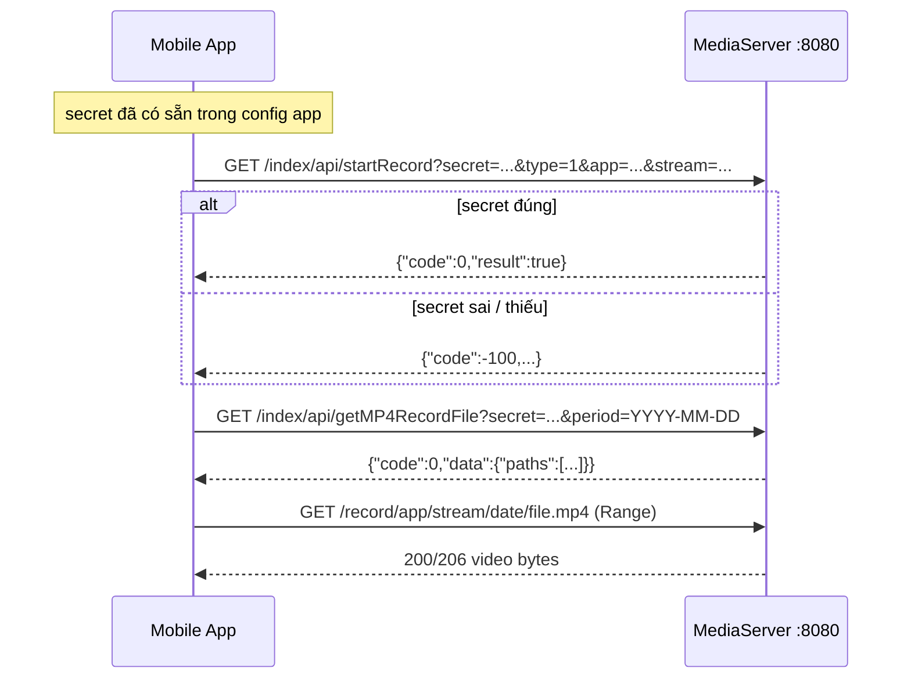
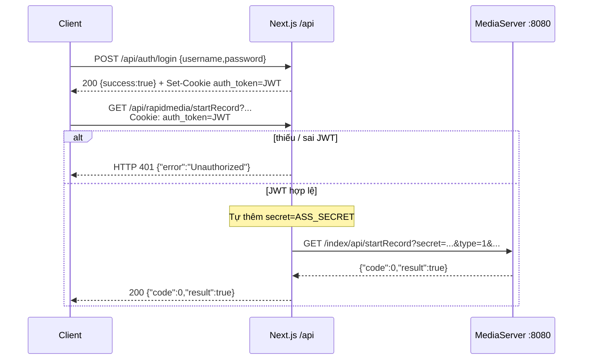
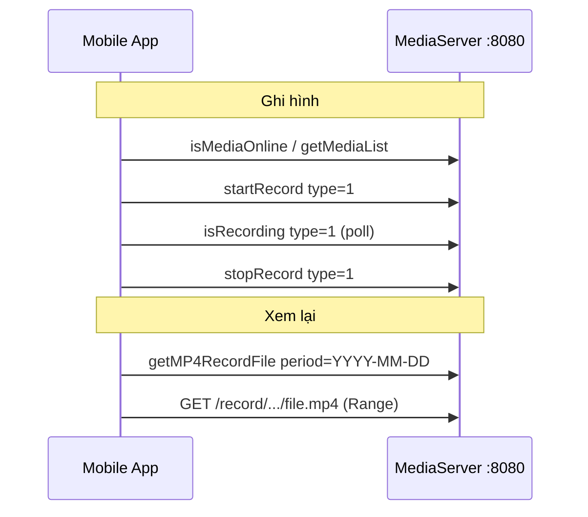

# Mobile Recording API

Tài liệu này mô tả cách ứng dụng mobile (Android / iOS) dùng các API recording của HTML5STREAM MediaServer.

Nguồn sự thật trong code: `server/WebApi.cpp`, `src/Record/Recorder.*`, `conf/config.ini`.

> Có **hai đường** gọi recording. Mobile nên dùng **Luồng A** (MediaServer + `secret`). **Luồng B** (web login → cookie JWT) chỉ khi bắt buộc đi qua Next.js — đây cũng là nơi phát sinh HTTP `401` nếu thiếu cookie. Dự án **không** có field tên `access_token`.

---

## 1. Tổng quan

| Mục                    | Giá trị                                                              |
| ---------------------- | -------------------------------------------------------------------- |
| MediaServer base       | `http://<media-host>:8080`                                           |
| Web (Next.js) base     | `http://<web-host>` (dashboard / BFF)                                |
| Prefix API MediaServer | `/index/api/<action>`                                                |
| Prefix proxy web       | `/api/rapidmedia/<action>`                                           |
| Method                 | `GET` hoặc `POST` (cùng action)                                      |
| Content-Type POST      | `application/x-www-form-urlencoded` hoặc `application/json`          |
| Path                   | Không phân biệt hoa thường (`getMP4RecordFile` ≡ `getMp4RecordFile`) |
| Vhost mặc định         | `__defaultVhost__` (khi `general.enableVhost=0`)                     |

### Envelope JSON (MediaServer)

```json
{
  "code": 0,
  "msg": "success"
}
```

| `code` | Ý nghĩa                          |
| ------ | -------------------------------- |
| `0`    | Thành công                       |
| `-1`   | Lỗi nghiệp vụ                    |
| `-100` | Sai / thiếu `secret`             |
| `-300` | Thiếu tham số bắt buộc           |
| `-400` | Exception                        |
| `-500` | Không tìm thấy stream / resource |

---

## 2. Luồng auth → gọi recording (tránh 401)

### Credential thực tế trong code

| Tên thường gọi nhầm | Tên thật trong hệ thống | Ở đâu                                                                          | Ai dùng                        |
| ------------------- | ----------------------- | ------------------------------------------------------------------------------ | ------------------------------ |
| `access_token`      | **Không tồn tại**       | —                                                                              | —                              |
| JWT / session       | Cookie **`auth_token`** | `Set-Cookie` sau `POST /api/auth/login`                                        | Client gọi web `/api/*`        |
| API key MediaServer | Query/body **`secret`** | `[api] secret` trong `conf/config.ini` (hoặc env `ASS_SECRET` phía web inject) | Client gọi `:8080/index/api/*` |



---

### Luồng A — Mobile khuyến nghị (không login web)

Không cần username/password web. Không cần JWT. Chỉ cần **`secret`**.

#### Bước 1 — Chuẩn bị thông tin

| Thông tin        | Nguồn                              | Ví dụ                      |
| ---------------- | ---------------------------------- | -------------------------- |
| `MEDIA_BASE`     | Host chạy MediaServer              | `http://192.168.1.10:8080` |
| `secret`         | `conf/config.ini` → `[api] secret` | `ASS2026SecretKey`         |
| `vhost`          | Thường cố định                     | `__defaultVhost__`         |
| `app` / `stream` | Camera / proxy đã publish          | `live` / `cam01`           |

App lưu `secret` trong config an toàn (Keychain / Keystore / remote config). **Không** lấy từ `/api/auth/login`.

#### Bước 2 — Gọi recording kèm `secret` mỗi request

```bash
# 1) Kiểm tra đang ghi?
curl "http://192.168.1.10:8080/index/api/isRecording?secret=ASS2026SecretKey&type=1&vhost=__defaultVhost__&app=live&stream=cam01"

# 2) Bắt đầu ghi MP4
curl "http://192.168.1.10:8080/index/api/startRecord?secret=ASS2026SecretKey&type=1&vhost=__defaultVhost__&app=live&stream=cam01"

# 3) Liệt kê file trong ngày
curl "http://192.168.1.10:8080/index/api/getMP4RecordFile?secret=ASS2026SecretKey&vhost=__defaultVhost__&app=live&stream=cam01&period=2026-08-14"

# 4) Phát file (URL file thường không cần secret; vẫn bị IP allowlist)
# http://192.168.1.10:8080/record/live/cam01/2026-08-14/<file>.mp4
```

#### Bước 3 — Đọc kết quả auth

- Thành công: `"code": 0`
- Sai/thiếu `secret`: `"code": -100` (thường **không** phải HTTP 401)
- IP ngoài allowlist: bị từ chối truy cập dịch vụ — mở `[http] allow_ip_range` hoặc dùng VPN



---

### Luồng B — Qua web (login → `auth_token` → recording)

Dùng khi app/gọi thử buộc đi qua Next.js (`/api/rapidmedia`, `/api/media`, `/api/recordings/delete`). Đây là luồng **duy nhất** có “token sau login”; tên cookie là **`auth_token`**, không phải `access_token`.

#### Bước 1 — Login lấy session JWT

```http
POST /api/auth/login
Content-Type: application/json

{"username":"admin","password":"admin"}
```

| Kết quả                                                  | Ý nghĩa                       |
| -------------------------------------------------------- | ----------------------------- |
| HTTP 200 + `{ "success": true }`                         | Đúng mật khẩu                 |
| HTTP 401 + `{ "error": "Invalid username or password" }` | Sai user/pass                 |
| HTTP 400                                                 | Thiếu `username` / `password` |

Response **không** trả JWT trong JSON. JWT nằm ở header:

```http
Set-Cookie: auth_token=<JWT>; Path=/; HttpOnly; SameSite=Strict; Max-Age=604800
```

- Bootstrap user (DB chưa sẵn): `admin` / `admin` (`web/src/app/api/auth/login/route.ts`)
- JWT TTL: 7 ngày; ký bằng `JWT_SECRET` (fallback: `rapidmedia_super_secret_fallback_key_2026`)
- Client **phải lưu và gửi lại** cookie `auth_token` cho mọi `/api/*` tiếp theo

```bash
# Lưu cookie vào file
curl -i -c cookies.txt -X POST "http://<web-host>/api/auth/login" \
  -H "Content-Type: application/json" \
  -d '{"username":"admin","password":"admin"}'

# Kiểm tra cookies.txt có auth_token=...
```

Trên native app: đọc header `Set-Cookie`, lấy giá trị `auth_token`, lưu vào CookieJar / SecureStorage, gắn `Cookie: auth_token=<JWT>` mỗi request web. (Cookie `HttpOnly` + `SameSite=Strict` khiến trình duyệt web tự gửi trong cùng site; native app phải tự quản lý.)

#### Bước 2 — Gọi recording qua proxy (đừng tự truyền `secret`)

Web verify `auth_token` trước; nếu OK mới **tự inject** `ASS_SECRET` / `RAPIDMEDIA_SECRET` rồi forward sang MediaServer. Client **không** cần (và không nên) biết `secret` trên đường này.

```bash
# Status / start / stop / list — không gửi secret từ client
curl -b cookies.txt \
  "http://<web-host>/api/rapidmedia/isRecording?type=1&vhost=__defaultVhost__&app=live&stream=cam01"

curl -b cookies.txt \
  "http://<web-host>/api/rapidmedia/startRecord?type=1&vhost=__defaultVhost__&app=live&stream=cam01"

curl -b cookies.txt \
  "http://<web-host>/api/rapidmedia/getMP4RecordFile?vhost=__defaultVhost__&app=live&stream=cam01&period=2026-08-14"
```

Hoặc gắn tay JWT đã lấy được:

```bash
curl -H "Cookie: auth_token=<JWT>" \
  "http://<web-host>/api/rapidmedia/stopRecord?type=1&vhost=__defaultVhost__&app=live&stream=cam01"
```

Phát file qua web proxy (cũng cần `auth_token`):

```
GET /api/media/record/{app}/{stream}/{YYYY-MM-DD}/{file}.mp4
Cookie: auth_token=<JWT>
```

#### Bước 3 — Bên trong proxy xảy ra gì (tránh nhầm 401)



| HTTP từ web                           | Nguyên nhân                                       | Cách xử lý                                      |
| ------------------------------------- | ------------------------------------------------- | ----------------------------------------------- |
| `401` `Unauthorized`                  | Không gửi cookie / JWT hết hạn / sai `JWT_SECRET` | Login lại bước 1, gửi lại `auth_token`          |
| `401` lúc login                       | Sai username/password                             | Đúng credential user                            |
| `200` + body MediaServer `code: -100` | Web inject sai `ASS_SECRET` so với MediaServer    | Đồng bộ env web với `config.ini` `[api] secret` |

Logout: `POST /api/auth/logout` → xóa cookie `auth_token`.

---

### Chọn luồng nào?

| Tiêu chí             | Luồng A (`secret` → `:8080`)           | Luồng B (login → `auth_token` → `/api/*`) |
| -------------------- | -------------------------------------- | ----------------------------------------- |
| Mobile native        | **Nên dùng**                           | Khó (cookie httpOnly / SameSite)          |
| Tránh HTTP 401       | Dùng `secret` đúng → không gặp 401 web | Phải luôn mang `auth_token`               |
| Ẩn `secret` khỏi app | Không (app giữ secret hoặc BFF riêng)  | Có — web giữ `ASS_SECRET`                 |
| Login user/password  | Không                                  | Có                                        |

**Tóm tắt một dòng:** muốn tránh `401` trên recording → hoặc (A) gọi `:8080` kèm `secret`, hoặc (B) login lấy cookie `auth_token` rồi **mọi** request `/api/rapidmedia/*` và `/api/media/*` đều gửi cookie đó. Đừng tìm `access_token` trong body login.

### Phân biệt lỗi auth nhanh

| Hiện tượng                                            | Layer                     | Fix                       |
| ----------------------------------------------------- | ------------------------- | ------------------------- |
| HTTP `401` từ `/api/rapidmedia/*` hoặc `/api/media/*` | Thiếu `auth_token`        | Chạy lại Luồng B bước 1–2 |
| HTTP `401` từ `/api/auth/login`                       | Sai user/pass             | Đổi credential            |
| JSON `code: -100` từ `/index/api/*`                   | Sai/thiếu `secret`        | Sửa Luồng A bước 1        |
| HTTP `401` từ `/index/api/downloadFile`               | Path / `on_http_access`   | Dùng `/record/...mp4`     |
| Bị chặn dù đúng credential                            | IP ngoài `allow_ip_range` | Mục IP bên dưới           |

### IP allowlist (quan trọng trên mobile)

`[http] allow_ip_range` mặc định chỉ cho loopback + LAN RFC1918. Client LTE/5G / IP public sẽ bị từ chối nếu không:

- mở allowlist (để trống = không giới hạn), hoặc
- đi qua VPN / private network / reverse proxy nội bộ.

API control (`CHECK_SECRET`) và truy cập file HTTP đều bị ảnh hưởng bởi allowlist khi hook `on_http_access` trống.

---

## 3. Kiến trúc dữ liệu ghi hình

### Loại ghi (`type`)

| `type` | Ý nghĩa            | Gợi ý mobile                                                                                 |
| ------ | ------------------ | -------------------------------------------------------------------------------------------- |
| `0`    | HLS-TS             | Trùng với live HLS nếu stream đã `enable_hls=1` — tránh dùng để “bật/tắt record” trên mobile |
| `1`    | MP4 (khuyến nghị)  | File VOD + ExoPlayer / AVPlayer                                                              |
| `2`    | HLS-fMP4           | Archive HLS fMP4                                                                             |
| `3`    | HTTP-fMP4 live mux | Không phải lưu file archive                                                                  |
| `4`    | HTTP-TS live mux   | Không phải lưu file archive                                                                  |

### Cấu trúc thư mục MP4

Khi `enableVhost=0`:

```
{mp4_save_path}/record/{app}/{stream}/{YYYY-MM-DD}/{YYYY-MM-DD}-{HH}-{MM}-{SS}-{index}.mp4
```

Ví dụ (`mp4_save_path=/mnt/nvr/rapidmedia/www`):

```
/mnt/nvr/rapidmedia/www/record/live/cam01/2026-08-14/2026-08-14-12-00-00-0.mp4
```

- `mp4_max_second` (mặc định `120`): độ dài mỗi slice.
- File đang ghi có tiền tố `.` và **không** xuất hiện trong list cho đến khi đóng slice.

### URL phát HTTP (khuyến nghị mobile)

Khi `mp4_save_path` nằm dưới HTTP root (hoặc đã map `virtualPath`):

```
http://<host>:8080/record/{app}/{stream}/{YYYY-MM-DD}/{file}.mp4
```

Hỗ trợ HTTP Range / `206 Partial Content` — phù hợp ExoPlayer, AVPlayer, Flutter `video_player`.

---

## 4. Flow chuẩn cho mobile



### A. Bắt đầu / dừng ghi MP4

1. Stream live phải đang online (`app`/`stream` đã publish hoặc proxy).
2. `startRecord` với `type=1`.
3. Poll `isRecording` với `type=1`.
4. `stopRecord` với `type=1` (đóng slice hiện tại).

### B. Liệt kê + phát file

1. `getMP4RecordFile` với `period=YYYY-MM-DD` → danh sách file.
2. Phát trực tiếp URL `/record/.../*.mp4` (không cần `secret` trên URL file; vẫn bị IP allowlist).
3. Xóa: `deleteRecordDirectory` + `name=<file>`.

### C. Phát có seek / tốc độ (DVR protocol)

1. `loadMP4File` tạo stream ảo (`app=vod`, `stream=sessionId`).
2. Phát qua FLV / fMP4 / WebRTC / RTSP trên stream đó.
3. `seekRecordStamp` / `setRecordSpeed` với **`schema` bắt buộc** (thường `rtsp`).

---

## 5. API chi tiết

Tất cả URL dưới đây là relative tới `http://<host>:8080`.

### 5.1 `startRecord` — Bắt đầu ghi

```
GET|POST /index/api/startRecord
```

| Tham số           | Bắt buộc | Mô tả                                                    |
| ----------------- | -------- | -------------------------------------------------------- |
| `secret`          | có\*     | API secret                                               |
| `type`            | có       | `0`–`4` (mobile: `1`)                                    |
| `vhost`           | có       | `__defaultVhost__`                                       |
| `app`             | có       | App của live stream                                      |
| `stream`          | có       | Stream id                                                |
| `customized_path` | không    | Ghi đè root lưu; rỗng = config                           |
| `max_second`      | không    | Độ dài slice MP4 (giây); `0` = `protocol.mp4_max_second` |

**Response:**

```json
{ "code": 0, "result": true, "msg": "success" }
```

**Lỗi thường gặp:**

- `code: -500` — stream chưa online (`can not find the stream`)
- `code: -1` — `start record failed`

**Ví dụ:**

```bash
curl "http://192.168.1.10:8080/index/api/startRecord?secret=SECRET&type=1&vhost=__defaultVhost__&app=live&stream=cam01"
```

---

### 5.2 `stopRecord` — Dừng ghi

```
GET|POST /index/api/stopRecord
```

| Tham số                | Bắt buộc | Mô tả                   |
| ---------------------- | -------- | ----------------------- |
| `secret`               | có\*     |                         |
| `type`                 | có       | Phải khớp loại đã start |
| `vhost`,`app`,`stream` | có       |                         |

```json
{ "code": 0, "result": true, "msg": "success" }
```

```bash
curl "http://192.168.1.10:8080/index/api/stopRecord?secret=SECRET&type=1&vhost=__defaultVhost__&app=live&stream=cam01"
```

> `stopRecord type=0` có thể tắt luôn live HLS của stream đó.

---

### 5.3 `isRecording` — Trạng thái đang ghi

```
GET|POST /index/api/isRecording
```

| Tham số                                | Bắt buộc |
| -------------------------------------- | -------- |
| `secret`,`type`,`vhost`,`app`,`stream` | có       |

```json
{ "code": 0, "status": true }
```

`status` là boolean. Mobile nên luôn dùng `type=1` khi kiểm tra ghi MP4.

---

### 5.4 `startRecordTask` — Clip sự kiện (GOP lookback)

```
GET|POST /index/api/startRecordTask
```

Ghi clip ngắn: lấy GOP cache về trước + tiếp tục ghi thêm phía trước.

| Tham số                | Bắt buộc | Mô tả                                                                   |
| ---------------------- | -------- | ----------------------------------------------------------------------- |
| `secret`               | có\*     |                                                                         |
| `vhost`,`app`,`stream` | có       | Stream live đang chạy                                                   |
| `path`                 | có       | Tên file tương đối dưới thư mục MP4, hoặc absolute nếu bắt đầu bằng `/` |
| `back_ms`              | có       | Lookback từ GOP cache (ms)                                              |
| `forward_ms`           | có       | Tiếp tục ghi sau trigger (ms)                                           |

```json
{
  "code": 0,
  "msg": "",
  "data": { "path": "/mnt/nvr/rapidmedia/www/record/live/cam01/event1.mp4" }
}
```

Yêu cầu `[rtp_proxy] gop_cache` bật (mặc định có). Nếu tắt: lỗi `frame gop cache disabled...`.

```bash
curl "http://192.168.1.10:8080/index/api/startRecordTask?secret=SECRET&vhost=__defaultVhost__&app=live&stream=cam01&path=alarm-01.mp4&back_ms=10000&forward_ms=10000"
```

---

### 5.5 `getMP4RecordFile` — Liệt kê ngày / file

```
GET|POST /index/api/getMP4RecordFile
```

| Tham số                | Bắt buộc | Mô tả                                        |
| ---------------------- | -------- | -------------------------------------------- |
| `secret`               | có\*     |                                              |
| `vhost`,`app`,`stream` | có       | App/stream **live gốc**, không phải `record` |
| `period`               | không    | Tiền tố ngày                                 |
| `customized_path`      | không    |                                              |

**Hành vi `period`:**

| `period`                                  | Kết quả                                        |
| ----------------------------------------- | ---------------------------------------------- |
| `2026-08` (≠ 10 ký tự)                    | Danh sách **thư mục ngày** bắt đầu bằng prefix |
| `2026-08-14` (đúng 10 ký tự `YYYY-MM-DD`) | Danh sách **file** trong ngày đó               |

Không đệ quy. Không trả `size` / `duration` — chỉ tên file.

```json
{
  "code": 0,
  "data": {
    "rootPath": "/mnt/nvr/rapidmedia/www/record/live/cam01/2026-08-14/",
    "paths": ["2026-08-14-12-00-00-0.mp4", "2026-08-14-12-02-00-0.mp4"]
  }
}
```

**Gợi ý UI mobile:** parse giờ từ tên file `...-HH-MM-SS-index.mp4`; ước lượng kết thúc = start + `mp4_max_second` hoặc start của file kế tiếp.

```bash
# Danh sách ngày trong tháng
curl "http://192.168.1.10:8080/index/api/getMP4RecordFile?secret=SECRET&vhost=__defaultVhost__&app=live&stream=cam01&period=2026-08"

# Danh sách file trong ngày
curl "http://192.168.1.10:8080/index/api/getMP4RecordFile?secret=SECRET&vhost=__defaultVhost__&app=live&stream=cam01&period=2026-08-14"
```

---

### 5.6 `deleteRecordDirectory` — Xóa file / thư mục

```
GET|POST /index/api/deleteRecordDirectory
```

| Tham số                | Bắt buộc | Mô tả                                |
| ---------------------- | -------- | ------------------------------------ |
| `secret`               | có\*     |                                      |
| `vhost`,`app`,`stream` | có       |                                      |
| `period`               | không    | Append `{period}/` vào path          |
| `name`                 | không    | Có → xóa 1 file; không → xóa thư mục |
| `customized_path`      | không    |                                      |

```bash
# Xóa một file
curl "http://192.168.1.10:8080/index/api/deleteRecordDirectory?secret=SECRET&vhost=__defaultVhost__&app=live&stream=cam01&period=2026-08-14&name=2026-08-14-12-00-00-0.mp4"

# Xóa cả ngày
curl "http://192.168.1.10:8080/index/api/deleteRecordDirectory?secret=SECRET&vhost=__defaultVhost__&app=live&stream=cam01&period=2026-08-14"
```

Nếu đang ghi MP4 và xóa thư mục, server bỏ qua file tạm `/.*.mp4` rồi xóa phần còn lại.

---

### 5.7 `loadMP4File` — Nạp MP4 thành stream phát lại

```
GET|POST /index/api/loadMP4File
```

| Tham số                | Bắt buộc | Mô tả                                                       |
| ---------------------- | -------- | ----------------------------------------------------------- |
| `secret`               | có\*     |                                                             |
| `vhost`,`app`,`stream` | có       | Id stream ảo sẽ publish                                     |
| `file_path`            | có       | Absolute file, thư mục `.mp4`, hoặc nhiều path ngăn bởi `;` |
| `file_repeat`          | không    | Lặp lại                                                     |
| `seek_ms`              | không    | Offset bắt đầu (ms)                                         |
| `speed`                | không    | Tốc độ phát                                                 |
| ProtocolOption         | không    | VD `enable_hls=1` nếu cần HLS từ VOD                        |

`auto_close=true`: hết viewer → stream tự đóng.

```json
{ "code": 0, "data": { "duration_ms": 118400 } }
```

Sau đó phát (ví dụ):

```
http://<host>:8080/vod/play1.live.flv
http://<host>:8080/vod/play1.live.mp4
rtsp://<host>/vod/play1
```

---

### 5.8 `seekRecordStamp` — Seek VOD protocol

```
GET|POST /index/api/seekRecordStamp
```

| Tham số                | Bắt buộc | Mô tả                                                                |
| ---------------------- | -------- | -------------------------------------------------------------------- |
| `secret`               | có\*     |                                                                      |
| `schema`               | có       | Protocol của nguồn đang phát: `rtsp`, `rtmp`, `ts`, `fmp4`, `hls`, … |
| `vhost`,`app`,`stream` | có       | Stream VOD đã load / app `record`                                    |
| `stamp`                | có       | Vị trí ms                                                            |

```json
{ "code": 0, "result": 0, "msg": "success" }
```

> **Không** seek được file HTTP progressive `/record/...mp4`. Seek chỉ áp dụng cho MediaSource đã publish (sau `loadMP4File` hoặc VOD app `record`). OpenAPI/Postman cũ có thể thiếu `schema` — thiếu sẽ `code: -300`.

---

### 5.9 `setRecordSpeed` — Đổi tốc độ VOD

```
GET|POST /index/api/setRecordSpeed
```

| Tham số                                          | Bắt buộc |
| ------------------------------------------------ | -------- |
| `secret`,`schema`,`vhost`,`app`,`stream`,`speed` | có       |

`speed` hợp lệ khoảng **0.1 – 20**.

```bash
curl "http://192.168.1.10:8080/index/api/setRecordSpeed?secret=SECRET&schema=rtsp&vhost=__defaultVhost__&app=vod&stream=play1&speed=2.0"
```

---

### 5.10 `getSnap` — Snapshot JPEG

```
GET|POST /index/api/getSnap
```

| Tham số       | Bắt buộc | Mô tả                                                      |
| ------------- | -------- | ---------------------------------------------------------- |
| `secret`      | có\*     |                                                            |
| `url`         | có       | URL live hoặc recording (VD `rtmp://127.0.0.1/live/cam01`) |
| `timeout_sec` | có       | Timeout FFmpeg                                             |
| `expire_sec`  | có       | Cache còn hạn thì trả ảnh cũ                               |
| `async`       | không    |                                                            |

**Response không phải JSON** — body là `image/jpeg` (hoặc ảnh mặc định / text lỗi FFmpeg).

Cần cấu hình `[ffmpeg]`. Mobile nên dùng như tải ảnh thumbnail.

```bash
curl -o snap.jpg "http://192.168.1.10:8080/index/api/getSnap?secret=SECRET&url=rtsp://127.0.0.1/live/cam01&timeout_sec=10&expire_sec=5"
```

---

### 5.11 `downloadFile` — Download theo absolute path

```
GET|POST /index/api/downloadFile
```

| Tham số     | Bắt buộc | Mô tả                                                                          |
| ----------- | -------- | ------------------------------------------------------------------------------ |
| `file_path` | có       | Absolute; phải nằm trong `[api] downloadRoot` (`;`-separated). Không chứa `..` |
| `save_name` | không    | `Content-Disposition`                                                          |

**Không** dùng `CHECK_SECRET`, nhưng vẫn qua `on_http_access` / IP allowlist. Mobile nên ưu tiên URL `/record/...` thay vì API này.

---

## 6. URL phát lại trên mobile

### 6.1 HTTP MP4 progressive (khuyến nghị)

```
http://<host>:8080/record/{app}/{stream}/{YYYY-MM-DD}/{file}.mp4
```

| Platform     | Gợi ý                            |
| ------------ | -------------------------------- |
| Android      | ExoPlayer / Media3 + Range       |
| iOS          | AVPlayer                         |
| Flutter      | `video_player` / `better_player` |
| React Native | `expo-av` / `react-native-video` |

Không cần gọi `seekRecordStamp` — player seek native trên file MP4.

### 6.2 Protocol VOD tự động (app = `record`)

`[record] appName=record`. Phát với `app=record` và `stream` = phần path còn lại:

```
rtsp://<host>/record/{app}/{stream}/{YYYY-MM-DD}/{file}.mp4
rtmp://<host>/record/{app}/{stream}/{YYYY-MM-DD}/{file}.mp4
http://<host>:8080/record/{app}/{stream}/{YYYY-MM-DD}/{file}.mp4.live.flv
http://<host>:8080/record/{app}/{stream}/{YYYY-MM-DD}/{file}.mp4.live.mp4
```

Không còn viewer → nguồn VOD đóng sau `streamNoneReaderDelayMS` (mặc định ~20s).

### 6.3 HLS archive (nếu ghi HLS / `segNum=0` / `segKeep=1`)

```
http://<host>:8080/{app}/{stream}/{YYYY-MM-DD}/{HH}/vod.m3u8
http://<host>:8080/{app}/{stream}/{YYYY-MM-DD}/{HH}/vod.fmp4.m3u8
```

### 6.4 WebRTC playback của recording

Không có API WebRTC riêng cho recording. Nạp bằng `loadMP4File` (hoặc VOD app `record`), rồi:

```
POST /index/api/webrtc?app=vod&stream=play1&type=play
Content-Type: text/plain

<SDP offer>
```

hoặc WHEP:

```
POST /index/api/whep?app=vod&stream=play1
Content-Type: application/sdp
```

WebRTC play tra nguồn RTSP nội bộ → stream cần `enable_rtsp`. Signaling/ICE xem `webrtc/USAGE.md`. Endpoint WebRTC **không** yêu cầu `secret`.

---

## 7. API hỗ trợ liên quan

### Kiểm tra stream đang live

```
GET /index/api/getMediaList?secret=SECRET
GET /index/api/isMediaOnline?secret=SECRET&schema=rtsp&vhost=__defaultVhost__&app=live&stream=cam01
```

Trong `getMediaList`, mỗi item có `isRecordingMP4`, `isRecordingHLS`.

### Ghi kèm lúc tạo proxy

Khi `addStreamProxy` / `addFFmpegSource`, truyền `enable_mp4=1` (và tuỳ chọn `mp4_max_second`, `mp4_save_path`) để tự ghi thay vì gọi `startRecord` thủ công. Dashboard “auto record” dùng cơ chế này.

### Capability node

```
GET /api/v1/center/capabilities?secret=SECRET
```

```json
"recording": { "mp4": true, "hls": true, "snapshot": true }
```

Chỉ phản ánh compile flag, không phải dung lượng đĩa.

---

## 8. Hook (tuỳ chọn — sync phía server)

Khi đóng slice MP4/TS, MediaServer gọi `on_record_mp4` / `on_record_ts` với:

| Field                                | Ý nghĩa                                                       |
| ------------------------------------ | ------------------------------------------------------------- |
| `start_time`                         | Unix time (giây)                                              |
| `time_len`                           | Độ dài (giây)                                                 |
| `file_size`                          | Byte                                                          |
| `file_path` / `file_name` / `folder` | Đường dẫn disk                                                |
| `url`                                | Relative play path, VD `record/live/cam01/2026-08-14/....mp4` |
| `vhost`,`app`,`stream`               | Stream gốc                                                    |

Mobile không gọi hook; backend có thể dùng để index metadata / upload S3.

---

## 9. Cấu hình liên quan (`conf/config.ini`)

| Section / key                                    | Ảnh hưởng mobile                                                     |
| ------------------------------------------------ | -------------------------------------------------------------------- |
| `api.secret` / `legacyAuth`                      | Auth API control                                                     |
| `api.snapRoot` / `downloadRoot`                  | Snap & download jail                                                 |
| `protocol.enable_mp4`                            | Tự ghi mọi publish                                                   |
| `protocol.mp4_max_second`                        | Độ dài slice                                                         |
| `protocol.mp4_save_path`                         | Root lưu MP4 — phải phục vụ được qua HTTP nếu muốn URL `/record/...` |
| `protocol.hls_save_path`                         | Root HLS                                                             |
| `record.appName`                                 | App VOD tự động (`record`)                                           |
| `record.fileRepeat` / `fastStart` / `enableFmp4` | Hành vi VOD / file                                                   |
| `http.rootPath` / `virtualPath`                  | Map file ra URL                                                      |
| `http.allow_ip_range`                            | Chặn/mở client WAN                                                   |
| `rtp_proxy.gop_cache`                            | Bắt buộc cho `startRecordTask`                                       |
| `ffmpeg.*`                                       | `getSnap`                                                            |

---

## 10. Ví dụ tích hợp mobile (pseudo)

### Kotlin — start + list + play URL

```kotlin
val base = "http://192.168.1.10:8080"
val secret = "SECRET"
val vhost = "__defaultVhost__"
val app = "live"
val stream = "cam01"

// Start MP4 record
apiGet("$base/index/api/startRecord?secret=$secret&type=1&vhost=$vhost&app=$app&stream=$stream")

// List today
val day = "2026-08-14"
val list = apiGet("$base/index/api/getMP4RecordFile?secret=$secret&vhost=$vhost&app=$app&stream=$stream&period=$day")
val file = list.data.paths.first()

// Play with ExoPlayer (Range)
val playUrl = "$base/record/$app/$stream/$day/$file"
exoPlayer.setMediaItem(MediaItem.fromUri(playUrl))
```

### Swift — stop + delete

```swift
let base = "http://192.168.1.10:8080"
let q = "secret=SECRET&type=1&vhost=__defaultVhost__&app=live&stream=cam01"
_ = try await get("\(base)/index/api/stopRecord?\(q)")

let del = "secret=SECRET&vhost=__defaultVhost__&app=live&stream=cam01&period=2026-08-14&name=2026-08-14-12-00-00-0.mp4"
_ = try await get("\(base)/index/api/deleteRecordDirectory?\(del)")
```

---

## 11. Checklist triển khai mobile

1. MediaServer reachable từ thiết bị (LAN / VPN); kiểm tra `allow_ip_range`.
2. Auth mobile = `secret` trên `:8080`. Không chờ `access_token`; chỉ dùng cookie `auth_token` nếu cố ý gọi web `/api/*`.
3. Giữ `secret` ở phía app config an toàn (không hardcode public build nếu node expose WAN — ưu tiên proxy/BFF).
4. Luôn dùng `type=1` cho MP4 start/stop/isRecording.
5. Đảm bảo stream online trước `startRecord`.
6. Playback mặc định: HTTP Range `/record/...mp4`.
7. Chỉ dùng `loadMP4File` + seek/speed khi cần điều khiển server-side hoặc WebRTC.
8. `mp4_save_path` và HTTP root phải cùng cây thư mục (hoặc `virtualPath`) — nếu không, list OK nhưng play URL 404.
9. Tránh Next.js `/api/rapidmedia` trên mobile (JWT cookie httpOnly khó gắn từ native app).
10. Gặp HTTP `401` trên web API → login `/api/auth/login`; gặp `code: -100` trên MediaServer → sửa `secret`.
11. File đang ghi (dotfile) chưa list được — đợi đóng slice / hook.
12. List API không có duration — tự ước lượng từ tên file + `mp4_max_second`.

---

## 12. Tham chiếu code

| Nội dung                        | File                                           |
| ------------------------------- | ---------------------------------------------- |
| Đăng ký HTTP API                | `server/WebApi.cpp`                            |
| Mã lỗi / `CHECK_SECRET`         | `server/WebApi.h`                              |
| Loại recorder & path            | `src/Record/Recorder.h`, `Recorder.cpp`        |
| Slice MP4                       | `src/Record/MP4Recorder.cpp`                   |
| VOD reader                      | `src/Record/MP4Reader.cpp`                     |
| Event clip                      | `src/Common/MultiMediaSourceMuxer.cpp`         |
| Hook record                     | `server/WebHook.cpp`                           |
| Web login → cookie `auth_token` | `web/src/app/api/auth/login/route.ts`          |
| JWT sign/verify                 | `web/src/lib/auth.ts`                          |
| Proxy recording + check JWT     | `web/src/app/api/rapidmedia/[action]/route.ts` |
| OpenAPI (thiếu một số field)    | `www/swagger/openapi.json`                     |
| Postman                         | `postman/ZLMediaKit.postman_collection.json`   |
| UI dashboard tham khảo          | `web/src/app/dashboard/recordings/page.tsx`    |
| Admin JS                        | `www/admin/app.js`                             |
